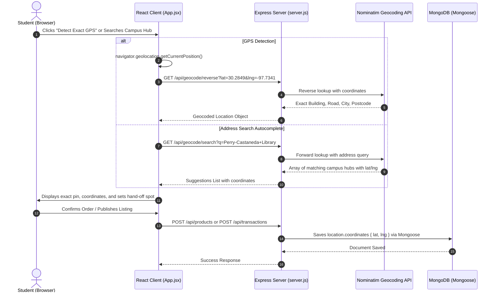

# CampusCart — Project Structure & Architecture

**CampusCart** is a modern student-to-student campus marketplace designed for buying, selling, and exchanging used textbooks, calculators, electronics, bicycles, lab equipment, and college essentials within a university campus. Built by **Team NexByte** (`24BCE321`, `24BCE327`) using the high-converting e-commerce design style (forest green `#003d29` header, warm peach `#fcede3` hero banner, interactive category chips, 5-star rating cards, multi-variant detail views, and seamless hand-off checkout with **Geocoding API** for exact location detection and **Mongoose** for backend data modeling).

---

## 1. Directory Tree

```text
FSD_Final/
│
├── .gitignore                   # Git ignore specifications (node_modules, logs, dist, env)
├── package.json                 # Monorepo root scripts & Concurrently dev runner
├── package-lock.json            # Root dependency lockfile
├── README.md                    # Project documentation, team info, Geocoding API & setup guide
├── PROJECT_STRUCTURE.md         # Complete repository structure & architecture (this file)
│
├── client/                      # React Frontend Application (Vite + Tailwind CSS + Vanilla CSS)
│   ├── index.html               # Main HTML entry point (CampusCart title, Plus Jakarta Sans, SVG favicon)
│   ├── package.json             # Frontend dependencies (React 18, Tailwind CSS v4, Lucide icons, Axios)
│   ├── package-lock.json        # Frontend dependency lockfile
│   ├── vite.config.js           # Vite configuration with React, Tailwind v4 plugin, & /api proxy
│   └── src/
│       ├── main.jsx             # React DOM root mounting with StrictMode
│       ├── index.css            # Normal CSS custom properties, keyframe animations, scrollbars, & utilities
│       └── App.jsx              # Complete CampusCart SPA:
│                                #  ├── 1. Top Announcement Bar (Forest Green #003d29, English Only)
│                                #  ├── 2. Sticky Navbar with Categories, Search, Cart & User
│                                #  ├── 3. Hero Promo Banner (Peach #fcede3 with 50% Off CTA)
│                                #  ├── 4. Filter & Sort Bar (7 interactive chips)
│                                #  ├── 5. "Headphones For You!" / Campus Listings (8 Product Cards, Shopcart White Card Style)
│                                #  ├── 6. "Popular Categories" Grid (Books, Electronics, Bikes, etc.)
│                                #  ├── 7. "Similar Items You Might Like" (4 Product Cards)
│                                #  ├── 8. "Recently Viewed" (4 Product Cards)
│                                #  ├── 9. Product Details View (Breadcrumbs, Gallery, Swatches, Stepper)
│                                #  ├── 10. Delivery Information & Payment Checkout View (Campus Hubs)
│                                #  ├── 11. Slide-Over Cart Drawer
│                                #  ├── 12. Sell / Post Listing Modal (With Strict Auth Gating & GPS Pinning)
│                                #  ├── 13. Contact Seller Direct Message Modal
│                                #  ├── 14. Campus Delivery Hubs Modal
│                                #  ├── 15. Student Authentication & Profile Modal (Login, Register, Demo Fills, Role Switcher)
│                                #  ├── 16. My Campus Listings & Post Item Modal (Auth Gated, Rupees System ₹ INR)
│                                #  ├── 17. Campus Orders & Transaction Tracking View (GPS Pins & Rupees)
│                                #  ├── 19. Admin Moderation Dashboard & Campus Transaction Ledger (₹)
│                                #  ├── 20. Toast Notification System
│                                #  └── 21. Modern University Marketplace Footer (English Only, ₹ INR)
│
└── server/                      # Node.js / Express Backend Application
    ├── .env                     # Server environment configuration (PORT, MONGO_URI, JWT_SECRET)
    ├── package.json             # Server dependencies (Express, Mongoose, JWT, bcrypt, CORS)
    ├── package-lock.json        # Server dependency lockfile
    └── server.js                # Express REST API, Mongoose models, & Geocoding API endpoints:
                                 #  ├── GET /api/health (Health check)
                                 #  ├── GET /api/geocode/reverse (GPS Coordinates -> Exact Address)
                                 #  ├── GET /api/geocode/search (Address Query -> Coordinates)
                                 #  ├── Mongoose Models: User, Product, Transaction, Wishlist, Report
                                 #  └── REST Routes: Products CRUD, Auth, My Listings, Transactions
```

---

## 2. Geocoding API Integration Architecture

CampusCart integrates the **OpenStreetMap Nominatim Geocoding API** for exact student hand-off coordination:



---

## 3. Mongoose Schemas & Data Models

### 1. `Product` Schema
```javascript
const productSchema = new mongoose.Schema({
  title: { type: String, required: true, trim: true },
  description: { type: String, required: true, trim: true },
  category: {
    type: String,
    required: true,
    enum: ['Books & Notes', 'Electronics', 'Calculators', 'Lab Equipment', 'Bicycles', 'Furniture', 'Sports Equipment', 'Other Essentials']
  },
  price: { type: Number, required: true, min: 0 },
  condition: { type: String, required: true, enum: ['New', 'Like New', 'Good', 'Fair'] },
  image: { type: String },
  seller: { type: mongoose.Schema.Types.ObjectId, ref: 'User', required: true },
  college: { type: String, required: true },
  location: {
    address: { type: String, default: 'Central Campus Library' },
    city: { type: String, default: 'Austin' },
    coordinates: {
      lat: { type: Number, default: 30.2849 },
      lng: { type: Number, default: -97.7341 }
    }
  },
  status: { type: String, enum: ['Available', 'Reserved', 'Sold'], default: 'Available' },
  createdAt: { type: Date, default: Date.now }
});
```

### 2. `Transaction` Schema
```javascript
const transactionSchema = new mongoose.Schema({
  product: { type: mongoose.Schema.Types.ObjectId, ref: 'Product', required: true },
  buyer: { type: mongoose.Schema.Types.ObjectId, ref: 'User', required: true },
  seller: { type: mongoose.Schema.Types.ObjectId, ref: 'User', required: true },
  status: { type: String, enum: ['Pending', 'Accepted', 'Rejected', 'Completed', 'Cancelled'], default: 'Pending' },
  deliveryLocation: {
    address: { type: String, default: 'Central Campus Library' },
    city: { type: String, default: 'Austin' },
    coordinates: {
      lat: { type: Number, default: 30.2849 },
      lng: { type: Number, default: -97.7341 }
    }
  },
  paymentMethod: { type: String, default: 'cash_on_meetup' },
  message: { type: String, default: '' },
  createdAt: { type: Date, default: Date.now },
  updatedAt: { type: Date, default: Date.now }
});
```

---

## 4. Design System Tokens

- **Brand Green (Primary)**: `#003d29` (Used for TopBar, primary buttons, logo badge, and accents)
- **Brand Green Hover**: `#025238`
- **Brand Green Light Tint**: `#e6f3ee` (Used for active badge backgrounds and highlights)
- **Hero Peach Background**: `#fcede3` (Warm welcoming background matching Figma mockups)
- **Card Background Gray**: `#f5f6f8` (Neutral tone for clean product cutouts)
- **Star Green (Rating)**: `#0fa958` (Vibrant emerald rating stars)
- **Language**: English Only across all interfaces, notifications, and labels
